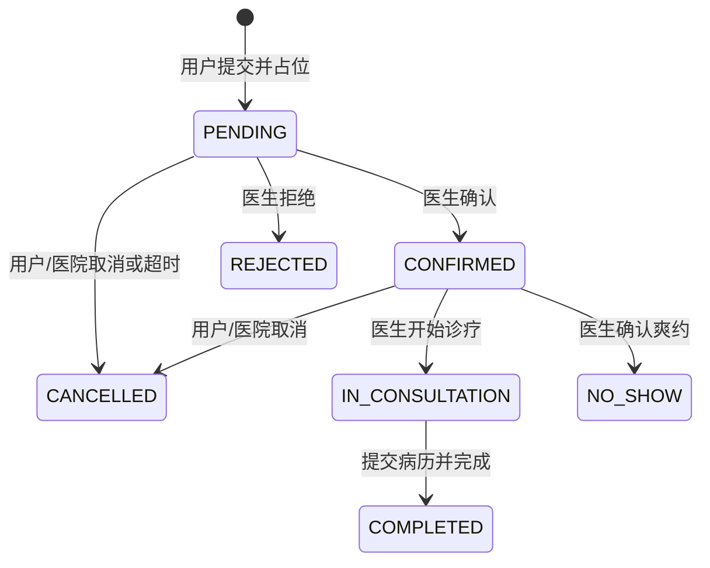

# AI 问诊宠物医院系统功能清单

版本：V1.0 设计稿；日期：2026-10-22。业务基线来自已确认需求；本文补充的默认时限、容量和数据可见期限属于可配置设计默认值。

## 1 定位与范围

三套业务界面：用户端、医生端、管理员端。两个客户端：微信小程序和 Web。小程序承载用户端，Web 按角色呈现医生和管理员界面。Spring Boot 统一提供业务服务，MySQL 保存业务数据，独立向量检索服务保存知识向量，私有文件存储保存附件。DeepSeek 负责回答生成，独立 Embedding 模型负责文本向量化。

首版按单家医院设计。包括账号、宠物、日常日志、临床档案、AI 问诊、知识库、预约排班、健康内容、权限、文件、审计和报表。暂不包含支付收费、药品库存、住院、医生人工在线聊天、多医院管理和 AI 影像诊断。用户可上传附件供医生查看。

2026-10-28 已确定技术基线：Java21/Spring Boot3.5、Vue3/Element Plus、MySQL8.4、中文 BGE small + Qdrant、SeaweedFS 私有S3。完整版本、选型依据和模块任务见[任务总体进度](../doc/tasks/progress.md)。接口和表设计通过 Adapter 隔离供应商。

## 2 功能清单与验收

下表功能编号同时用于数据库和接口文档的追踪。

| 编号 | 端/角色 | 功能与关键操作 | 验收条件 |
|---|---|---|---|
| F01 | 全端 | 登录、退出、查看/修改个人资料、修改密码；小程序支持微信登录及账号注册登录 | 医生/管理员由管理员开通；用户注册不能自选后台角色；停用和退出后令牌失效 |
| F02 | 用户 | 添加、编辑、查看、归档宠物；查看按时间排列的健康记录 | 用户仅操作自己的宠物；归档不删除病历；有未终结预约或生成中会话时不得归档 |
| F03 | 用户 | 新增、修改自己的日常健康日志，记录饮食、排便、活动、体重与附件 | 日志标识“用户自述”；修改记录审计；不能写入医生诊断字段 |
| F04 | 用户/医生 | 查看临床病历；医生保存草稿、提交、修订，用户只读 | 原始病历和每次修订均可追溯；修订须填写原因；管理员不能直接修改临床结论 |
| F05 | 用户/医生 | 按宠物建立 AI 会话，多轮追问，查看历史和引用资料；医生查看预约关联会话 | MySQL 保存消息、输出和调用状态；不同宠物会话隔离；每次建议固定含免责声明 |
| F06 | 系统/医生 | 症状初筛、规则识别、模型风险辅助、立即就医提示；医生审核规则 | 高危规则先返回提示；模型和向量库故障不阻止规则提示；无命中不等于排除急症 |
| F07 | 管理员/医生 | 管理知识草稿与版本、医生审核、分块、Embedding、向量索引、发布/下架、检索预览 | 未审核、索引未就绪、下架资料不参与新回答；引用保存版本；旧回答仍可追溯 |
| F08 | 用户/管理员 | 浏览健康指南，管理员新增编辑上下架；医生只读 | 小程序只返回已发布指南；浏览事件按用户与文章按日去重 |
| F09 | 用户/医生/管理员 | 查询通用健康标准；医生维护专业内容，管理员管理发布 | 标准注明物种、年龄范围、单位、来源和适用条件；不跨物种套用 |
| F10 | 用户/医生/管理员 | 医生列表、可预约时段；医生维护本人排班，管理员统筹排班 | 时段时间不重叠，容量为正；已有预约的时段不能直接删改日期、医生和起止时间 |
| F11 | 用户/医生/管理员 | 用户选医生、时段和宠物提交；医生确认/拒绝、开始/完成诊疗、标记爽约；用户/医院取消 | 仅七种预约主状态；并发不超售；重复提交不重复占位；操作受状态及身份限制 |
| F12 | 用户/医生 | 提出、接受、拒绝、撤回改期；管理员查看和协助取消 | 改期同医生、不同未来时段；未接受保留原时间；接受时重新验容量，原子迁移名额 |
| F13 | 医生 | 本人待处理预约、今日接诊、已完成记录；查看获授权宠物的日志/病历和关联 AI 会话 | 不能通过改 ID 查看其他医生宠物；既往病历可读，修订只限本人署名病历 |
| F14 | 管理员 | 用户/医生账号、角色、菜单、权限配置；个人账号停用 | 默认 USER/DOCTOR/ADMIN；后端逐次鉴权；管理员也受临床写权限限制 |
| F15 | 授权角色 | 上传头像、宠物图片、日志和检查报告；私有附件授权下载、解绑 | 校验实际类型/大小；文件只能绑定授权业务；没有永久公开病历地址 |
| F16 | 用户/后台 | 预约确认、拒绝、取消、改期、诊疗完成等站内消息，未读和已读 | 通知与业务同事务保存、提交后可见；重复业务请求不重复发消息；微信订阅通知为后续扩展 |
| F17 | 管理员 | 查看关键操作审计、病历版本、预约变更、文件访问、角色变更 | 修改与审计同事务；无日志编辑删除接口；普通运行日志不包含密钥、密码和完整病历 |
| F18 | 管理员/医生 | 医院运营报表，医生仅本人工作量 | 指标有固定时间口径和分母；没有收费模块不展示营业收入和利润 |
| F19 | 用户 | 查看/接受隐私告知与 AI 服务告知、撤回 AI 授权 | 存储版本和同意时间；撤回后不再发起新模型请求，仍可使用非 AI 功能 |

## 3 角色与数据范围

| 资源 | 用户 | 医生 | 管理员 |
|---|---|---|---|
| 宠物基础信息/日志 | 自己的宠物；可维护 | 本人已确认/诊疗中预约的宠物，或本人完成接诊后 30 天内；只读 | 全院管理；涉及自述的纠错保留来源和审计 |
| 临床病历 | 自己宠物已提交版本，只读 | 上述宠物历史已提交病历可读；只写本人病历 | 按审计/运营权限只读；不改诊断 |
| AI 会话 | 自己的会话 | 只读本人符合授权范围的预约所关联会话；不自动开放全部聊天 | 仅单独授权的审计权限可读，普通报表只返回聚合 |
| 预约 | 自己提交的预约 | 本人预约；未确认仅显示本单必要信息 | 全院统筹；不代替医生开始/完成诊疗 |
| 排班/时段 | 可预约时段摘要 | 本人时段 | 全院时段 |
| 知识内容 | 只读公开且已发布资料及引用 | 专业审核/急症规则审核/健康标准维护 | 编辑、申请审核、索引和发布/下架 |
| 审计与报表 | 不开放全院信息 | 本人工作量、本人病历版本 | 对应细分权限；导出需另授权限 |

30 天为建议默认值。医生对本人已提交病历在期限外需要修订时，只开放该病历及其版本，不扩大到该宠物其他数据。跨医生修改原病历不允许；后续接诊医生新增自己的病历。授权依据在后端关联预约验证，菜单或请求中的角色字段不能授予权限。

## 4 预约规则

| 状态 | 中文 | 可执行的下一步 |
|---|---|---|
| PENDING | 待确认 | 确认、拒绝、取消、申请改期 |
| CONFIRMED | 已确认 | 开始、取消、标记爽约、申请改期 |
| IN_CONSULTATION | 诊疗中 | 保存病历草稿、提交病历并完成 |
| COMPLETED | 已完成 | 终态；病历可另行修订 |
| REJECTED | 已拒绝 | 终态 |
| CANCELLED | 已取消 | 终态；记录 USER/DOCTOR/ADMIN/SYSTEM 及原因 |
| NO_SHOW | 已爽约 | 终态 |

设计默认值：提前 14 天开放预约；时段建议 30 分钟、容量默认 1，可配置。待确认时即占位，确认不重复扣名额；待确认截止时间取提交后 24 小时与时段开始时间的较早值，超时以 SYSTEM 取消并释放。确认/改期接口必须同时检查截止时间，不能只依靠定时任务。

用户在时段开始前可取消；开始时间后由医生/管理员处理取消。已确认超过时段开始 30 分钟可由医生标记爽约；系统只提醒。诊疗开始可提前 15 分钟；开始较晚也须由医生实际操作，不能由时钟自动推进。诊疗中异常中断仍由医生完成实际发生的病历并说明结果，不增加预约状态。

同一宠物不能有时间重叠的待确认、已确认或诊疗中预约；同一医生排班不得重叠。容量不足、时段关闭、医生停用、宠物归档均拒绝新预约。关闭已有预约的时段只阻止新提交，原预约须逐单取消或改期。

改期申请状态为 OPEN/ACCEPTED/REJECTED/WITHDRAWN/EXPIRED，与预约主状态分离；每单最多一个 OPEN。新时段不预留名额，接受时才抢占。新时段满员或关闭返回冲突、原预约不变，申请继续 OPEN 直至失效/撤回。有效期为提出后 24 小时、原时段开始、新时段开始、原确认截止时间（仅待确认）中的最早时间。任一预约主状态变更使未处理改期失效。待确认改期接受后仍待确认，确认截止只可缩短为原截止与新时段开始的较早值，不可延长；已确认改期接受后仍已确认。

## 5 临床档案与 AI 边界

每个预约最多一份正式病历，病历含主诉、医生检查、诊断、治疗/用药、复诊建议和附件。草稿不向用户展示。完成诊疗必须同事务提交病历初版、追加版本、推进预约、写审计与通知。后续修订必须提供预期版本号和原因；旧版本只追加不覆盖。

AI 输出包含风险级别、风险依据、可能原因（非确诊）、追问项、护理建议、避免事项和引用。每次建议由服务端固定添加“AI 生成可能有误，请以线下诊断为主”。AI 内容不自动写入医生诊断字段；医生可以参考后独立填写。

高危规则在模型调用前执行；识别实际发生、物种、持续时间和否定语境，避免把“没有抽搐”或“如果抽搐怎么办”当成已发生。高危命中直接生成固定就医提示并落库，首版跳过该轮自由生成。规则未命中才走 RAG 和 DeepSeek；模型可提高风险，不能降低已发现风险。明确是非猫犬物种而规则覆盖不足时，显示覆盖限制并建议咨询相关兽医，不套用猫犬规则。

RAG 只检索审核通过、索引就绪、当前已发布版本。每条引用保存文档标题、版本、片段快照和检索分数。未检索到可靠依据时说明资料不足，继续安全追问或建议就医。知识片段按参考数据传入，不能作为修改系统规则的指令。

## 6 运营报表口径

全部按 Asia/Shanghai 展示；数据库 UTC，查询采用开始含、结束不含。按预约创建时间的业务量和按时段开始时间的接诊结果分别返回，不能混为同一分母。

| 指标 | 统计口径/来源 |
|---|---|
| 新增用户/宠物 | 创建时间在区间内，按主键去重 |
| 活跃用户（登录口径） | 区间内至少成功登录一次的不同用户，来源 audit_log 中 AUTH_LOGIN 事件；不以会被覆盖的 last_seen_at 回算历史 |
| 新建预约量 | appointment.created_at 在区间内 |
| 待处理预约 | 当前 PENDING 且未过确认截止时间 |
| 确认率 | 创建批次中 confirmed_at 非空的预约 / 该批次全部预约；分母含后续取消 |
| 完成率/取消率/爽约率 | 时段开始位于区间且已结束的批次中对应当前状态数量 / 该批次全部预约；同时列出未终结数 |
| 医生接诊量 | completed_at 在区间且对应本人；不等同于病历修订次数 |
| 平均确认耗时 | confirmed_at-created_at；仅首次确认成功的记录 |
| AI 会话量/问诊人数/轮数 | 区间内有用户消息的会话/不同用户；成功建议数为有效轮数 |
| 急症提示占比 | 最终 EMERGENCY 的用户消息轮数 / 已完成风险处理的用户消息轮数；同轮多规则不重复计数 |
| AI 到预约转化 | 起始于区间且已满 7 天的会话中，首次 7 天内创建并显式关联预约的会话 / 此成熟会话批次；不能推断因果 |
| 模型成功率/响应耗时 | ai_call_log 中 COMPLETED 调用 / 已结束调用；重试分开计；P50/P95 由服务计算 |
| Token/费用 | 实际调用 usage 汇总；无价格配置仅展示 Token，不能虚构费用 |
| 指南热度 | guide_view_event 按用户、文章、自然日去重后的浏览量 |
| 宠物种类/年龄结构 | 当前未归档宠物；生日未知单独列未知 |
| 常见症状 | triage_event 中规则/模型提取的规范症状代码去重按轮计，不将 AI 推测疾病作为确诊分布 |

首版每页报表按需 SQL 聚合，AI 转化使用 ai_session 与 appointment.ai_session_id；不额外建立数仓。

## 7 关键验收场景

1. 用户 A 无法读取用户 B 的宠物、消息、病历与文件；后台菜单权限不能绕过对象归属。
2. 两人同时抢最后一个名额，仅一人成功；相同幂等键重发只产生一单。
3. 医生拒绝/取消释放一次名额；重复请求不重复释放。
4. 改期目标满员/超时/医生停用时原预约和名额不变；接受成功同时释放旧名额。
5. 并发取消和开始诊疗仅一个成功；终态不可被任意 PATCH 回待确认。
6. 无病历不能完成；病历提交失败则预约仍诊疗中；并发修订返回版本冲突。
7. 模型或向量库故障时保留用户消息、记录失败；急症规则仍能返回提示。
8. 知识下架后不出现在新检索，历史引用仍能查看原文快照。
9. 医生未确认前不能浏览该用户全部健康数据；确认后只读授权宠物资料。
10. 模型重试不重复插入用户消息、覆盖旧建议或自动重试扣费。

下一份：[数据库设计](02-database-design.md)；接口见 [接口设计](03-api-design.md)。
