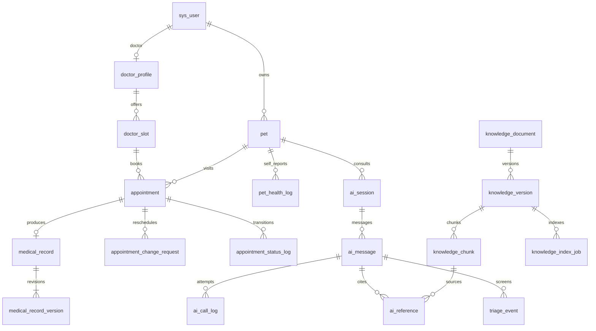

# AI 问诊宠物医院系统数据库设计

版本：V1.0 逻辑及字段设计稿；日期：2026-10-22。本文定义 33 张 MySQL 业务表及外部向量结构，后续可据此生成 DDL。尚未执行建库或迁移。

## 1 约定

2026-10-28 目标已确定为 MySQL 8.4.13 LTS/InnoDB，向量存储选 Qdrant 1.20.0；不再以原简介 MySQL5.7 为实现目标。本稿使用 BIGINT、VARCHAR、DATETIME(3)、DECIMAL、JSON、TEXT 等常规类型，不依赖 MySQL 原生向量字段。版本依据和执行任务见[任务总体进度](../doc/tasks/progress.md)。

- 主键 `id BIGINT` 由服务生成，API 以字符串传输，防止 JavaScript 数值精度丢失。关联 ID 与主键类型相同。
- 下列表格的 N 表示必填且不可为 NULL，Y 表示可空；`N/默认值` 表示默认值。唯一键记 UQ，普通索引记 IX。
- 全部实体表默认有 `created_at DATETIME(3) N`；可更新实体另有 `updated_at DATETIME(3) N`。关联表和不可变日志仅有 created_at，业务事件时间另列。
- 时刻存 UTC，接口 ISO 8601 带时区；自然日期 DATE 按医院 Asia/Shanghai 解释。金额若将来引入使用 DECIMAL。
- JSON 字段由服务端 DTO 做字段、长度、枚举校验；核心关联和可过滤字段不藏在 JSON 中。
- 逻辑外键关系见下文；DDL 阶段为同库强关联建立 FK RESTRICT，不配置级联删除病历、预约、问诊、版本和审计。多态附件用服务校验。
- `version INT N/0` 用于乐观锁；可更新实体根据下表列出，状态转换同时检查预期状态和 version。
- 不对全部表统一加软删除。宠物归档、账号停用、内容下架；不可变历史按留存策略处理。逻辑归档不等于履行个人信息删除请求。
- 当前首版单院，无 hospital_id；多院扩展需要完整的数据隔离迁移，不能仅补一个查询参数。

## 2 表与功能对应

| 分组 | 表 | 功能 |
|---|---|---|
| 身份权限 6 | sys_user、sys_role、sys_user_role、sys_menu、sys_role_menu、auth_session | F01/F14 |
| 医生 1 | doctor_profile | F10/F13 |
| 宠物档案 4 | pet、pet_health_log、medical_record、medical_record_version | F02/F03/F04 |
| 预约 4 | doctor_slot、appointment、appointment_status_log、appointment_change_request | F10/F11/F12 |
| AI 与分诊 6 | ai_session、ai_message、ai_call_log、ai_reference、triage_rule、triage_event | F05/F06 |
| RAG 4 | knowledge_document、knowledge_version、knowledge_chunk、knowledge_index_job | F07 |
| 健康内容 2 | health_guide、health_standard | F08/F09 |
| 文件 2 | file_object、file_binding | F15 |
| 记录与通知 4 | audit_log、user_notice、consent_record、guide_view_event | F16/F17/F18/F19 |



病历 DRAFT 时尚无正式版本；首次 SUBMITTED 后至少一个版本。ER 图表示提交后的关系。

## 3 身份权限

### 3.1 sys_user 账号

| 字段 | 类型/空 | 含义 |
|---|---|---|
| username | VARCHAR(64) Y | 账号登录名；微信直接注册时可空；非空 UQ |
| password_hash | VARCHAR(255) Y | 自适应密码哈希，微信用户未设密码可空 |
| wechat_openid_hash | CHAR(64) Y | 使用服务端密钥 HMAC 的 OpenID 查找值，UQ |
| wechat_openid_cipher | VARBINARY(512) Y | 需要调用微信服务时使用的加密标识，不返回客户端 |
| display_name | VARCHAR(64) N | 昵称 |
| phone_cipher | VARBINARY(512) Y | 加密手机号 |
| phone_masked | VARCHAR(32) Y | 展示值；原手机号只向必要授权提供 |
| avatar_file_id | BIGINT Y | 关联 file_object |
| status | VARCHAR(16) N/ACTIVE | ACTIVE/DISABLED |
| token_version | INT N/0 | 密码变更、停用等使旧令牌失效 |
| version | INT N/0 | 账号资料与角色关联更新的乐观锁 |

索引：UQ(username)、UQ(wechat_openid_hash)、IX(status,created_at)。注册用户名不重复使用已停用账号标识。用户不能提交 role、status、token_version 等服务字段。

### 3.2 sys_role 角色

`code VARCHAR(32) N UQ`、`name VARCHAR(64) N`、`status VARCHAR(16) N/ACTIVE`、`version INT N/0`。初始 USER/DOCTOR/ADMIN。后台角色关联不授予跨资源权限；临床写操作还必须存在启用的 doctor_profile 且是病历署名医生。角色权限集合更新也推进 version。

### 3.3 sys_user_role 用户角色关联

`user_id BIGINT N → sys_user`、`role_id BIGINT N → sys_role`。UQ(user_id,role_id)，IX(role_id)。仅 created_at。角色变更即时更新 token_version 并撤销会话。

### 3.4 sys_menu 菜单及权限点

`parent_id BIGINT Y → sys_menu`、`name VARCHAR(64) N`、`kind VARCHAR(16) N`（MENU/BUTTON）、`route_path VARCHAR(255) Y`、`permission_code VARCHAR(128) N UQ`、`sort_no INT N/0`、`status VARCHAR(16) N/ACTIVE`、`version INT N/0`。IX(parent_id,sort_no)。阻止父子循环；route 只做展示，permission_code 关联后端操作。

### 3.5 sys_role_menu 角色权限关联

`role_id BIGINT N → sys_role`、`menu_id BIGINT N → sys_menu`。UQ(role_id,menu_id)，IX(menu_id)。仅 created_at。

### 3.6 auth_session 登录会话

`user_id BIGINT N → sys_user`、`client_type VARCHAR(16) N`（MINI/WEB）、`refresh_token_hash CHAR(64) N UQ`、`family_id VARCHAR(64) N`、`expires_at DATETIME(3) N`、`revoked_at DATETIME(3) Y`、`last_seen_at DATETIME(3) N`、`rotated_to_id BIGINT Y → auth_session`。

IX(user_id,revoked_at)、IX(expires_at)、IX(last_seen_at)。JWT 带 sessionId、tokenVersion、aud；后端检查会话撤销、过期、账号状态和 token_version。刷新令牌只存哈希，轮换并检测旧令牌重用；会话活跃时间按节流策略更新，仅用于会话管理。历史登录活跃指标使用不可变 AUTH_LOGIN 审计事件，不能用最后活跃时间反推。

### 3.7 doctor_profile 医生资料

`user_id BIGINT N UQ → sys_user`、`doctor_name VARCHAR(64) N`、`title VARCHAR(64) Y`、`specialties VARCHAR(255) Y`、`introduction TEXT Y`、`qualification_file_id BIGINT Y → file_object`、`status VARCHAR(16) N/ACTIVE`、`version INT N/0`。

IX(status)。下文 doctor_id 均引用 doctor_profile.id，不是 sys_user.id；操作人 actor_user_id 均引用 sys_user.id。

## 4 宠物与临床档案

### 4.1 pet 宠物

`owner_user_id BIGINT N → sys_user`、`name VARCHAR(64) N`、`species_code VARCHAR(32) N`、`breed VARCHAR(64) Y`、`sex VARCHAR(16) N/UNKNOWN`（MALE/FEMALE/UNKNOWN）、`birth_date DATE Y`、`neutered VARCHAR(16) N/UNKNOWN`（YES/NO/UNKNOWN）、`avatar_file_id BIGINT Y`、`owner_health_notes TEXT Y`、`status VARCHAR(16) N/ACTIVE`（ACTIVE/ARCHIVED）、`version INT N/0`。

IX(owner_user_id,status)、IX(species_code,birth_date)。主人自述与医生结论分别标记。慢性病、过敏、当前用药由已提交病历及其结构化诊疗摘要生成，AI 快照注明来源日期，不能直接用宠物基础编辑覆盖。体重从最近日志/临床测量读取并带时间。

### 4.2 pet_health_log 日常健康日志

`pet_id BIGINT N → pet`、`author_user_id BIGINT N → sys_user`、`observed_at DATETIME(3) N`、`weight_kg DECIMAL(6,2) Y`、`diet_note TEXT Y`、`stool_note TEXT Y`、`activity_note TEXT Y`、`symptom_note TEXT Y`、`version INT N/0`。

IX(pet_id,observed_at,id)。体重大于 0；不能全部内容为空。作者必须是宠物主人。附件通过 file_binding。首版无硬删除接口，错误日志通过修订及 audit_log 留痕。

### 4.3 medical_record 临床病历当前视图

`appointment_id BIGINT N UQ → appointment`、`pet_id BIGINT N → pet`、`doctor_id BIGINT N → doctor_profile`、`status VARCHAR(16) N/DRAFT`（DRAFT/SUBMITTED）、`content_json JSON N`、`revision_no INT N/0`、`submitted_at DATETIME(3) Y`、`version INT N/0`。

IX(pet_id,submitted_at)、IX(doctor_id,submitted_at)。content_json 固定字段：chiefComplaint、examination、diagnosis、treatment、medications[]、allergies[]、chronicConditions[]、followupAdvice、followupAt、attachmentIds[]。用药含名称、医生填写剂量/频率/疗程，不接受 AI 自动写入。

appointment.pet_id/doctor_id 必须与病历一致，字段由后端取；草稿 revision_no=0。提交后 current 内容是最新正式版本的投影；更新内容和追加版本必须在同一事务完成。

### 4.4 medical_record_version 病历不可变版本

`record_id BIGINT N → medical_record`、`revision_no INT N`、`before_content_json JSON Y`（初版可空）、`after_content_json JSON N`、`reason VARCHAR(500) N`、`actor_user_id BIGINT N → sys_user`、`idempotency_key VARCHAR(64) N`。

UQ(record_id,revision_no)、UQ(record_id,idempotency_key)，仅 created_at。保存完整前后快照，首版原因为“首次提交”，后续要求具体修订原因。历史附件绑定到版本，不允许通过文件清理破坏历史证据。

## 5 排班与预约

### 5.1 doctor_slot 医生预约时段

`doctor_id BIGINT N → doctor_profile`、`slot_date DATE N`、`start_at DATETIME(3) N`、`end_at DATETIME(3) N`、`capacity INT N/1`、`occupied_count INT N/0`、`status VARCHAR(16) N/OPEN`（OPEN/CLOSED）、`version INT N/0`。

UQ(doctor_id,start_at)、IX(doctor_id,status,start_at)、IX(slot_date)。0≤occupied_count≤capacity，end_at>start_at。occupied_count 包含待确认、已确认、诊疗中、已完成和已爽约的历史占用；拒绝和取消释放，完成和爽约保留已消耗名额。只有未来 OPEN 时段向用户展示可预约数。doctor_profile 行锁保护同医生新建/调整排班时的重叠校验。

### 5.2 appointment 预约

| 字段 | 类型/空 | 含义 |
|---|---|---|
| appointment_no | VARCHAR(40) N UQ | 对外编号 |
| user_id / pet_id | BIGINT N | 提交人 → sys_user，宠物 → pet |
| doctor_id / slot_id | BIGINT N | → doctor_profile / doctor_slot |
| scheduled_start_at / scheduled_end_at | DATETIME(3) N | 预约当前时间快照；改期同时更新 |
| initial_start_at | DATETIME(3) N | 首次预约时间，供审计 |
| status | VARCHAR(24) N/PENDING | 七种主状态 |
| chief_complaint | VARCHAR(1000) N | 用户主诉 |
| ai_session_id | BIGINT Y → ai_session | 用户自选关联；同用户同宠物 |
| confirm_deadline_at | DATETIME(3) N | 待确认截止，不被改期延长 |
| confirmed_at / started_at / completed_at | DATETIME(3) Y | 首次确认、开始、完成时间 |
| cancelled_by / cancelled_at | VARCHAR(16) Y / DATETIME(3) Y | USER/DOCTOR/ADMIN/SYSTEM |
| terminal_reason | VARCHAR(500) Y | 拒绝/取消/爽约原因 |
| idempotency_key | VARCHAR(64) N | 创建请求键 |
| request_hash | CHAR(64) N | 规范化创建业务参数摘要；同键不同参数冲突 |
| version | INT N/0 | 并发控制 |

UQ(user_id,idempotency_key)、IX(user_id,created_at,id)、IX(doctor_id,status,scheduled_start_at)、IX(pet_id,status,scheduled_start_at)、IX(status,confirm_deadline_at)、IX(ai_session_id)、IX(completed_at)。

当前时段 doctor_id 必须一致。原时间、全部改期由 change_request 与审计保留；没有任意更新 status 的 CRUD 接口。姓名和电话不进入预约请求快照。

### 5.3 appointment_status_log 预约不可变状态日志

`appointment_id BIGINT N → appointment`、`from_status VARCHAR(24) Y`、`to_status VARCHAR(24) N`、`actor_type VARCHAR(16) N`、`actor_user_id BIGINT Y`（SYSTEM 可空）、`reason VARCHAR(500) Y`、`operation_key VARCHAR(64) N`、`request_hash CHAR(64) N`。

IX(appointment_id,created_at,id)、UQ(appointment_id,operation_key)。初始创建 from_status=NULL，拒绝、取消和爽约原因必填。幂等操作 key 与规范化请求 hash 对照，确保同键不同请求不误复用。

### 5.4 appointment_change_request 改期申请

`appointment_id BIGINT N → appointment`、`proposer_user_id BIGINT N → sys_user`、`proposer_type VARCHAR(16) N`（USER/DOCTOR）、`old_slot_id BIGINT N`、`new_slot_id BIGINT N`、`base_appointment_version INT N`、`old_start_at/new_start_at DATETIME(3) N`、`status VARCHAR(16) N/OPEN`、`open_guard TINYINT Y`、`reason VARCHAR(500) N`、`expires_at DATETIME(3) N`、`responder_user_id BIGINT Y`、`responded_at DATETIME(3) Y`、`response_reason VARCHAR(500) Y`、`idempotency_key VARCHAR(64) N`、`request_hash CHAR(64) N`、`version INT N/0`。

UQ(appointment_id,open_guard)，OPEN 时 open_guard=1，其余 NULL，利用 NULL 可重复实现每单一个未处理申请。UQ(appointment_id,proposer_user_id,idempotency_key)、IX(status,expires_at)。回应幂等使用状态+version 和 audit_log.operation_key。接受方为另一业务方，管理员不能代替接受。new_slot 必须同一医生且不同于 old_slot。

## 6 AI 对话与分诊

### 6.1 ai_session 问诊会话

`user_id BIGINT N → sys_user`、`pet_id BIGINT N → pet`、`title VARCHAR(128) N`、`status VARCHAR(16) N/OPEN`（OPEN/CLOSED）、`pet_snapshot_json JSON N`、`summary_text TEXT Y`、`summary_through_seq INT N/0`、`summary_version INT N/0`、`last_message_at DATETIME(3) Y`、`version INT N/0`。

IX(user_id,last_message_at,id)、IX(pet_id,created_at)。摘要只覆盖 seq≤summary_through_seq 的消息，近期消息从该边界之后组装，避免重复或漏轮。摘要失败保留旧边界并按 Token 预算截取原消息；关键过敏、用药和高危信号另外保留在结构化快照且带来源。原始消息不因摘要被删除。

### 6.2 ai_message 问诊消息

| 字段 | 类型/空 | 含义 |
|---|---|---|
| session_id | BIGINT N → ai_session | 所属会话 |
| seq_no | INT N | 单会话严格递增 |
| role | VARCHAR(16) N | USER/ASSISTANT |
| content | TEXT N | 用户原文或用户可见答案，不保存隐藏推理 |
| user_input_json | JSON Y | 原始结构化筛查问卷；ASSISTANT 为空 |
| reply_to_id | BIGINT Y → ai_message | AI 回复关联本轮用户消息 |
| source | VARCHAR(16) N | USER/MODEL/RULE/FALLBACK |
| processing_status | VARCHAR(24) N | 用户消息 QUEUED/PROCESSING/COMPLETED/FAILED/FAILED_UNKNOWN；回复固定 COMPLETED |
| client_message_id | VARCHAR(64) Y | 用户端幂等标识，AI 回复可空 |
| request_hash | CHAR(64) Y | 用户请求摘要；相同 clientMessageId 不同内容冲突 |
| answer_json | JSON Y | AI 结构化结果；用户消息为空 |
| risk_level | VARCHAR(16) Y | EMERGENCY/URGENT/ROUTINE/UNKNOWN |
| disclaimer | VARCHAR(128) Y | 所有 ASSISTANT 消息固定免责声明 |
| error_code | VARCHAR(64) Y | 失败代码，不保存凭证或完整堆栈 |
| processing_token | VARCHAR(64) Y | worker 领取令牌，完成时做 fencing 校验 |
| lease_until | DATETIME(3) Y | PROCESSING 超时检查 |
| generation_no | INT N/0 | 本轮显式重试序号 |
| version | INT N/0 | 乐观锁 |

UQ(session_id,seq_no)、UQ(session_id,client_message_id)、UQ(reply_to_id)、IX(processing_status,lease_until)、IX(session_id,role,created_at)。每条用户消息最多一个最终回复；失败明确重试才递增 generation_no，不改写已成功答案。会话行锁串行分配序号及领取消息，同一会话最多一个未结束用户轮，首版不并行多问题生成。

### 6.3 ai_call_log 模型调用记录

`session_id BIGINT Y → ai_session`、`user_message_id BIGINT Y → ai_message`、`call_kind VARCHAR(16) N`（GENERATION/SUMMARY/EMBEDDING）、`business_ref VARCHAR(128) N`（如消息ID/摘要边界/索引jobID）、`generation_no INT N/0`、`attempt_no INT N/1`、`provider VARCHAR(64) N`、`model VARCHAR(128) N`、`provider_request_id VARCHAR(128) Y`、`status VARCHAR(24) N`（CALLING/COMPLETED/FAILED/FAILED_UNKNOWN）、`prompt_version VARCHAR(32) Y`、`safety_version VARCHAR(32) Y`、`input_snapshot_json JSON Y`、`prompt_tokens / completion_tokens / cached_tokens INT Y`、`latency_ms BIGINT Y`、`started_at / finished_at DATETIME(3) Y`、`error_code VARCHAR(64) Y`。

UQ(call_kind,business_ref,generation_no,attempt_no)、IX(status,started_at)、IX(model,started_at)、IX(user_message_id)。input_snapshot_json 只保存去标识后的实际模型输入、摘要边界和宠物快照供追溯，受专门审计权限控制，不进入应用普通日志。外部模型失败时 Token 未知为 NULL，不能算 0。分诊规则直接回复不记 LLM 调用。

### 6.4 ai_reference 答案引用

`assistant_message_id BIGINT N → ai_message`、`document_id BIGINT N → knowledge_document`、`knowledge_version_id BIGINT N → knowledge_version`、`chunk_id BIGINT N → knowledge_chunk`、`rank_no INT N`、`score DECIMAL(10,6) N`、`title_snapshot VARCHAR(255) N`、`source_snapshot VARCHAR(1000) Y`、`content_snapshot TEXT N`、`embedding_profile VARCHAR(128) N`。

UQ(assistant_message_id,rank_no)、IX(chunk_id)。仅 created_at。引用只能从实际检索候选中选择，后端过滤模型虚构 ID。历史引用从快照读取，下架仅阻止未来检索。审核时必须避免把私人病历作为公共知识片段。

### 6.5 triage_rule 急症规则版本

`rule_code VARCHAR(64) N`、`revision_no INT N`、`species_code VARCHAR(32) N`、`title VARCHAR(128) N`、`predicate_json JSON N`、`risk_level VARCHAR(16) N`、`fixed_advice TEXT N`、`source_url VARCHAR(1000) N`、`review_status VARCHAR(16) N/DRAFT`（DRAFT/IN_REVIEW/APPROVED/REJECTED）、`enabled TINYINT N/0`、`creator_user_id BIGINT N`、`reviewer_user_id BIGINT Y`、`review_note VARCHAR(500) Y`、`reviewed_at DATETIME(3) Y`、`version INT N/0`。

UQ(rule_code,revision_no)、IX(enabled,review_status,species_code)。predicate_json 只允许预定义条件运算，不执行脚本或 SQL；新 revision 审核后启用时同事务关闭旧 revision。审核者需启用医生身份；急症示例不得未经医生审核直接启用。

### 6.6 triage_event 分诊事件

`user_message_id BIGINT N → ai_message`、`source VARCHAR(16) N`（RULE/MODEL）、`rule_id BIGINT Y → triage_rule`、`generation_no INT N/0`、`symptom_codes_json JSON N`、`evidence_json JSON N`、`risk_level VARCHAR(16) N`、`final_risk_level VARCHAR(16) N`、`rule_version_snapshot VARCHAR(64) Y`、`decision_json JSON N`。

IX(user_message_id,generation_no)、IX(final_risk_level,created_at)。仅 created_at。evidence 保留短证据、否定/未知标签和规则版本；多规则事件报表按 user_message_id 去重，以成功处理轮的最终风险计数。

## 7 知识库与向量检索

### 7.1 knowledge_document 知识文档

`title VARCHAR(255) N`、`species_code VARCHAR(32) N`、`category_code VARCHAR(64) N`、`tags_json JSON Y`、`status VARCHAR(16) N/DRAFT`（DRAFT/PUBLISHED/OFFLINE）、`active_version_id BIGINT Y → knowledge_version`、`creator_user_id BIGINT N`、`version INT N/0`。

IX(status,species_code,category_code)。这是发布入口，不把最大 version_no 当成已发布版本。曾发布过的文档禁止直接修改 species_code/category_code；重新分类需要新建文档并重新审核索引，避免已存向量过滤标签与 MySQL 不一致。

### 7.2 knowledge_version 知识版本

`document_id BIGINT N → knowledge_document`、`version_no INT N`、`content LONGTEXT N`、`source_title VARCHAR(255) N`、`source_url VARCHAR(1000) Y`、`source_file_id BIGINT Y → file_object`、`content_hash CHAR(64) N`、`review_status VARCHAR(16) N/DRAFT`、`reviewer_user_id BIGINT Y`、`review_note VARCHAR(500) Y`、`reviewed_at DATETIME(3) Y`、`published_at DATETIME(3) Y`、`version INT N/0`。

UQ(document_id,version_no)。审核状态 DRAFT/IN_REVIEW/APPROVED/REJECTED。审核通过内容不可原地编辑，修改新增版本。来源 URL 或文件至少一个；公开可访问不代表可无限复制，上传者须确认合法使用范围。无来源草稿不可提交审核。

### 7.3 knowledge_chunk 知识分块

`knowledge_version_id BIGINT N → knowledge_version`、`ordinal INT N`、`content TEXT N`、`content_hash CHAR(64) N`、`token_estimate INT N`、`splitter_version VARCHAR(64) N`。

UQ(knowledge_version_id,ordinal)，仅 created_at。同版本分块算法固定，已被引用片段不能改写。切换 splitter 必须新建知识版本，不以索引任务覆盖现有 chunk；仅更换 Embedding profile 可复用原片段。2026-10-28 选定 BAAI/bge-small-zh-v1.5 后，分块初始正文320 token、重叠48 token，使用同一tokenizer校验含特殊token总长度不超过512，不静默截断。此规则取代早期按400～800中文字估算的建议。

### 7.4 knowledge_index_job 向量索引任务

`knowledge_version_id BIGINT N → knowledge_version`、`embedding_profile VARCHAR(128) N`、`embedding_model VARCHAR(128) N`、`dimensions INT N`、`distance_metric VARCHAR(16) N`、`splitter_version VARCHAR(64) N`、`status VARCHAR(16) N/QUEUED`（QUEUED/RUNNING/READY/FAILED）、`active_guard TINYINT Y`、`indexed_chunks INT N/0`、`expected_chunks INT N/0`、`attempt_no INT N/1`、`lease_until DATETIME(3) Y`、`worker_token VARCHAR(64) Y`、`error_code VARCHAR(64) Y`、`started_at/finished_at DATETIME(3) Y`、`creator_user_id BIGINT N`、`idempotency_key VARCHAR(64) N`。

UQ(knowledge_version_id,embedding_profile,active_guard)，QUEUED/RUNNING 时 guard=1，否则 NULL；UQ(creator_user_id,idempotency_key)、IX(status,lease_until)。只有实际全部向量写入且核验完整才能 READY。任务幂等 upsert；失败允许新 attempt，不能把部分成功标成完成。

### 7.5 外部向量集合

此集合不算 MySQL 表。供应商已选 Qdrant，配置为中文 BGE small 的512维、Cosine距离、L2归一化；模型revision/profile在首模块锁定，约定如下：

```json
{
  "pointId": "UUID-derived-from-chunkId-and-embeddingProfile",
  "vector": [0.12, -0.08],
  "payload": {
    "chunkId": "10001",
    "documentId": "900",
    "versionId": "901",
    "speciesCode": "CAT",
    "categoryCode": "DIGESTIVE",
    "embeddingProfile": "profile-configured-at-deployment"
  }
}
```

数组只是结构示例，真实长度必须等于 dimensions。入库和查询使用相同模型/维度/预处理/距离度量的 profile，profile 作为完整配置指纹；切模型需重建独立索引，不混查旧向量。

候选先按 speciesCode 和 profile 过滤（物种通用条目可显式 COMMON），再 Top-K 检索，最后回 MySQL 验证 document.status=PUBLISHED、active_version_id=候选版本、该 profile 存在 READY job。可过量取候选再过滤补足；不足就返回资料不足。向量 payload 中的 published 标识不能成为唯一授权依据。

发布新版本采用 MySQL 内原子切换 active_version_id；切换前索引必须 READY。下架即改变 MySQL 状态，因此即使旧向量尚未清理也不能参与新回答。模型调用前再验证候选状态；历史答案引用保存生成时快照。索引任务和向量库是最终一致，失败不能改变当前发布指针。

## 8 健康内容

### 8.1 health_guide 健康指南

`title VARCHAR(255) N`、`species_code VARCHAR(32) N`、`category_code VARCHAR(64) N`、`body LONGTEXT N`、`cover_file_id BIGINT Y`、`source_note VARCHAR(1000) Y`、`status VARCHAR(16) N/DRAFT`（DRAFT/PUBLISHED/OFFLINE）、`published_at DATETIME(3) Y`、`editor_user_id BIGINT N`、`version INT N/0`。IX(status,published_at)、IX(species_code,category_code)。前端展示富文本做白名单清洗。指南发布不自动进入 RAG，需另建知识版本走审核。

### 8.2 health_standard 通用健康标准

`name VARCHAR(128) N`、`species_code VARCHAR(32) N`、`age_min_months/age_max_months INT Y`、`metric_code VARCHAR(64) N`、`unit VARCHAR(32) Y`、`reference_min/reference_max DECIMAL(12,4) Y`、`description TEXT N`、`conditions_note TEXT N`、`source_note VARCHAR(1000) N`、`status VARCHAR(16) N/DRAFT`、`editor_doctor_id BIGINT N → doctor_profile`、`version INT N/0`。

IX(status,species_code,metric_code)。标准可只有文本；数值成对出现且 min≤max；不把参考区间自动当成疾病诊断阈值。医生编辑专业正文后转为 DRAFT，管理员确认后重新发布；管理员仅切换发布状态。

## 9 文件、审计与通知

### 9.1 file_object 私有文件元数据

`uploader_user_id BIGINT N`、`object_key VARCHAR(512) N UQ`、`original_name VARCHAR(255) N`、`mime_type VARCHAR(128) N`、`size_bytes BIGINT N`、`sha256 CHAR(64) N`、`purpose VARCHAR(32) N`、`status VARCHAR(16) N`（QUARANTINED/READY/REJECTED/DELETED）、`validated_at DATETIME(3) Y`、`deleted_at DATETIME(3) Y`。

IX(uploader_user_id,created_at)、IX(status,created_at)。purpose 为 AVATAR/PET/HEALTH_LOG/MEDICAL/KNOWLEDGE/GUIDE/QUALIFICATION。物理文件存私有空间。元数据不暴露凭证；object_key 不直接作为 URL。

### 9.2 file_binding 业务附件关联

`file_id BIGINT N → file_object`、`business_type VARCHAR(32) N`、`business_id BIGINT N`、`owner_user_id BIGINT N`、`created_by BIGINT N`。

UQ(file_id,business_type,business_id)、IX(business_type,business_id)、IX(owner_user_id)。仅 created_at；business_type 白名单 PET/HEALTH_LOG/MEDICAL_DRAFT/MEDICAL_VERSION/KNOWLEDGE_VERSION/GUIDE/QUALIFICATION/USER_AVATAR。owner_user_id 不能作为唯一读权限依据，临床附件按关联病历/版本授权。用户原附件被医生采用时，需用户已在该单提交/授权，医生不能绑定无关文件。版本附件不允许解绑或物理删除。

### 9.3 audit_log 通用不可变审计

`actor_user_id BIGINT Y`、`actor_type VARCHAR(16) N`、`action VARCHAR(128) N`、`resource_type VARCHAR(64) N`、`resource_id BIGINT Y`、`before_json/after_json JSON Y`、`reason VARCHAR(500) Y`、`trace_id VARCHAR(64) N`、`operation_key VARCHAR(64) Y`、`request_hash CHAR(64) Y`、`result VARCHAR(16) N`（SUCCESS/FAILURE）、`ip_masked VARCHAR(64) Y`。

IX(resource_type,resource_id,created_at)、IX(actor_user_id,created_at)、IX(action,created_at,actor_user_id)、UQ(actor_user_id,operation_key)；用户业务写接口 operation_key 非空；SYSTEM 操作依靠业务唯一键去重。登录成功记录 AUTH_LOGIN 和 userId、时间，失败记录安全事件，不记录密码、原始 Token。只记录必要差异和脱敏字段，病历正文版本存专用表，审计引用 recordId/revisionNo。无通用修改删除 API。

### 9.4 user_notice 站内消息及可靠投递记录

`recipient_user_id BIGINT N`、`event_key VARCHAR(128) N`、`notice_type VARCHAR(32) N`、`title VARCHAR(128) N`、`body VARCHAR(1000) N`、`resource_type VARCHAR(64) N`、`resource_id BIGINT N`、`read_at DATETIME(3) Y`。

UQ(recipient_user_id,event_key)、IX(recipient_user_id,read_at,created_at)。与业务同事务插入，客户端提交后轮询可见，无需单独消息队列；body 不放完整病历、诊断或手机号。通知只是导航入口，打开资源再次鉴权。

### 9.5 consent_record 授权事件

`user_id BIGINT N`、`purpose VARCHAR(32) N`（PRIVACY/AI_SERVICE）、`policy_version VARCHAR(32) N`、`action VARCHAR(16) N`（ACCEPT/WITHDRAW）、`notice_hash CHAR(64) N`、`idempotency_key VARCHAR(64) N`。

UQ(user_id,idempotency_key)、IX(user_id,purpose,created_at,id)。仅 created_at，以最新事件判断有效授权；新模型请求与 worker 发起外呼前均校验。撤回不假定能撤销已发给供应商的请求；未发送任务停止。

### 9.6 guide_view_event 指南浏览事件

`guide_id BIGINT N → health_guide`、`user_id BIGINT N → sys_user`、`view_date DATE N`。

UQ(guide_id,user_id,view_date)、IX(view_date,guide_id)。仅 created_at；首次读取公开指南时写入，重复忽略；只存已登录用户的去重浏览，不能称为全网真实 PV。

## 10 核心事务与一致性

### 10.1 预约锁顺序

统一顺序：doctor_profile 行 → pet 行 → 涉及时段按 ID 升序 → appointment 行 → change_request 行。创建/改期接受时先锁医生行校验启用，锁 pet 检查该宠物其他有效预约时间重叠，再锁时段与预约；只影响已有预约的操作也遵守这个顺序。排班调整、医生停用同样先锁医生行，防止校验后医生被并发停用。候选 ID 可先非锁读获取，锁定后必须重读并验证 doctor_id/slot_id/version，变化则回滚重试。不要在持锁事务内调用 AI 或文件服务。

创建事务：校验幂等请求 → 锁宠物与时段 → 校验启用、未归档、未来时段、无时间重叠 → 原子增加 occupied_count（WHERE occupied_count<capacity AND status='OPEN'） → 插预约 → 插初始状态日志、审计、通知 → 提交。唯一键冲突时回滚整笔事务后再查原请求。

拒绝/取消事务：锁定后校验身份、状态和 version → 更新预约 → occupied_count 减 1（确认旧状态仍占位且非终态） → OPEN 改期失效并清 guard → 状态日志/审计/通知 → 提交。同键重放返回原状态事件结果，不再次减计数。

确认事务还校验 confirm_deadline_at；开始诊疗前使 OPEN 改期失效。完成/爽约不减少 occupied_count，保留历史容量消耗。定时清理待确认与改期超时仅调用相同状态服务，不能另写一套无锁 SQL。

### 10.2 改期接受

在统一锁顺序内核对双方身份、OPEN、expires_at、base_appointment_version、旧时段仍一致、新时段同医生且启用、宠物时间不重叠。新时段占位成功再释放旧时段，同事务更新 appointment 时间/slot_id/version、change_request=ACCEPTED/open_guard=NULL、审计和双方通知；PENDING 的 confirm_deadline_at 同步取原截止与新开始时间的较早值。主状态不变，因此不虚造状态日志，改期审计保存前后时间。失败整笔回滚，保留原预约。新提改期前，在相同预约锁内清理已过期 OPEN 申请并清 guard，防止定时任务延迟阻止新申请。

### 10.3 病历提交与修订

完成预约事务：锁定预约及病历 → 检查本人诊疗中和 DTO → 写 medical_record SUBMITTED/revision_no=1 → 写初版版本 → 绑定版本附件 → 更新 appointment COMPLETED/completed_at → 写状态日志、审计、通知。任何一步失败整笔回滚。病历修订以 version 条件更新，追加下一 revision_no，正文和附件版本均不可原地覆盖。

### 10.4 AI 与索引异步任务

接收消息短事务完成幂等去重、序号分配和 QUEUED 持久化。worker 以条件更新领取，设置 token/lease 后释放事务；执行规则/检索/外呼；最后用 token+generation_no 条件完成用户状态、AI 回复、引用、风险事件。超时 worker 结果被 fencing 拒绝，避免迟到结果覆盖人工重试。

调用前保存 ai_call_log CALLING；HTTP 超时且无法确认供应商是否完成时记 FAILED_UNKNOWN，不能无条件自动重发收费请求。用户显式重试后分配新 generation_no；已成功轮不允许重试覆盖。未外呼的确定性失败可安全重排。进程崩溃后扫描过期 lease，已外呼未落库的标 UNKNOWN 并向用户解释状态不确定。

索引任务可通过确定性 pointId 幂等重跑，但 READY 仅在核对所有 expected_chunks 后设置；worker_token 防止旧任务完成覆盖。业务数据库不与向量库做分布式事务，发布指针作为可见性门槛。

## 11 留存、备份与查询

首版建议配置而非写死：用户对话和去标识调用快照保存 180 天、调用元数据/审计 365 天；临床档案留存依据实际医院与适用要求另定，演示环境使用虚构数据。执行清理前检查病历/预约/引用依赖，历史引用依靠快照保留；删除授权/账号个人信息需要独立处理流程，不承诺归档等于彻底删除。

数据库及私有文件每日备份并加密，向量索引可由知识版本重建。日志系统只记录 traceId、ID、状态与耗时，不打印密码、JWT、API Key 和完整上下文。

初版分页采用 created_at/id 或业务时间/id 的稳定排序；聚合报表给范围上限，避免全表无界导出。确诊分布必须来自医生明确结构化的结论；本版症状分布来自 triage_event，不假称诊断准确率。

锁定读设计依据：[MySQL InnoDB Locking Reads](https://dev.mysql.com/doc/refman/8.4/en/innodb-locking-reads.html)。上下文持久化依据：[DeepSeek Multi-round Conversation](https://api-docs.deepseek.com/guides/multi_round_chat/)。

前一份：[功能清单](01-functional-spec.md)；下一份：[接口设计](03-api-design.md)。
